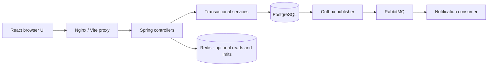

# Architecture and decisions

## Runtime

Java 21 / Spring Boot 4.1.1, React 19.3 / TypeScript, PostgreSQL. This is a modular monolith with one backend and one frontend. Python is not a dependency. Native local validation uses the machine's PostgreSQL 16.13; Compose and Testcontainers target PostgreSQL 18.1.

## Code boundaries

- Backend feature packages contain HTTP controllers; controllers validate DTOs and delegate.
- `catalog/MasterService` owns medicine and supplier maintenance. JPA repositories and entities implement master persistence; entities are never serialized directly.
- `stock/StockService` owns transactional purchases, FEFO sales and cancellation. `common/Store` centralizes parameterized JDBC access. JDBC is used deliberately for PostgreSQL `FOR UPDATE`, reporting SQL and outbox operations; it shares the same Spring transaction manager/data source as JPA. This is a documented variation from mapping every financial table as a JPA entity.
- `inventory/InventoryService` handles inventory aggregation and reporting reads. Values returned by JDBC are boundary projections, not persistent entities. Field names in these projections follow database snake_case. Request DTOs and authenticated-user records use camelCase.
- `auth/` owns authentication, `config/` owns wiring/jobs/security, `common/` contains cross-cutting input/error/persistence helpers. Feature controllers are separate from these helpers.
- React feature folders contain pages and feature-specific forms. `api/client.ts` handles auth/errors, `components/ui.tsx` contains shared components. TanStack Query is the source of server state. Login and master forms use React Hook Form + Zod; complex transaction rows use typed controlled form state and native validation, with Jakarta validation authoritative on the server.

## Stock invariants

Every mutation is a database transaction. Medicine rows are locked in ascending ID order, then eligible batch rows are locked explicitly. The medicine lock serializes first-batch creation and gives all stock writers a shared lock order. This trades some per-medicine concurrency for simpler correctness.

Sales select active batches with positive quantity and `expiry_date >= CURRENT_DATE`, sorted by expiry and ID. A medicine expiring today is sellable until that UTC date ends. Each allocation records its batch, price and quantity. Insufficient stock anywhere rolls back the entire sale. Money is PostgreSQL NUMERIC and Java BigDecimal; frontend totals are informational only.

Cancellation locks the sale, medicines and referenced batches, restores the recorded quantities, and records the reason/user/time. A repeated cancellation returns the cancelled sale without restoring stock again. Returned expired stock remains unsellable.

Existing `(medicine_id, batch_number)` receipts must have identical expiry/purchase price/selling price and ACTIVE status. Mismatches are 409; changes must be represented by a different physical batch identifier. Duplicate supplier invoice numbers are 409. There is no transaction hard-delete endpoint.

Available inventory excludes inactive/expired batches. Inactive medicines remain visible in inventory but cannot be sold. Low/out-of-stock views apply to active medicines. Stock valuation includes all on-hand units, including expired stock; it is not the sellable stock value. Dashboard day boundaries and report filters use UTC; dates/timestamps are displayed in the browser locale. Confirm business timezone before operational deployment.

## Authentication and permissions

- BCrypt cost 12; generated initial owner password is private in `.env` and only used if users table is empty.
- 256-bit random bearer token, SHA-256 hash stored in PostgreSQL, eight-hour expiry, explicit revocation on logout. No in-memory HTTP sessions, so multiple API instances share auth state.
- Browser uses sessionStorage; tokens are not cookies and are not automatically attached cross-site. CSRF is disabled for this bearer-only API. Same-origin proxying avoids broad CORS allowances.
- OWNER maintains masters, receives purchases, cancels sales and creates users. CASHIER can view inventory/masters/reports and create sales. User creation is available in Team. Account reset/deactivation and password change UI are not included in this V1.
- Login: 20 requests/minute per connection IP; authenticated API: 600/minute per user. Redis Lua counter with a PostgreSQL fallback. The proxy is not trusted for arbitrary X-Forwarded-For headers. With Nginx, login requests share the proxy-IP bucket; refine trusted-proxy rate limiting before a larger rollout.
- Health is public; other Actuator endpoints require owner access. A dedicated METRICS_TOKEN grants only the Prometheus path. Do not reuse it as a login token.

## Redis and RabbitMQ

Redis caches individual medicine/supplier reads for five minutes, with after-commit eviction. Cache errors fall back to PostgreSQL; inventory decisions never use cached quantities. Master lists are queried directly. TTL bounds staleness if eviction fails or a concurrent read races an update.

Business writes insert an outbox event inside their transaction. A scheduled publisher uses row locks with SKIP LOCKED, mandatory routing and publisher confirms; only acknowledged/routed messages are marked published. Delivery is at least once. The consumer deduplicates by event ID and stores an in-app inventory alert. Three consumer attempts precede dead-letter routing. Outages leave committed stock transactions intact and pending outbox rows retry every 10 seconds.

The native local profile disables Redis/RabbitMQ; Compose enables both. Email delivery, daily report files, distributed tracing/export workers and outbox retention tooling are later extensions. Current jobs cover alert notifications, token/rate cleanup and expiry status maintenance. The expiry date remains authoritative even before the maintenance job runs.

## Deliberate V1 limits

Optional create-sale idempotency keys are not implemented. The UI disables double submission; after an ambiguous network error, inspect sales history before retrying. Cancellation and supplier invoice uniqueness are safe to retry. Batch audit drill-down returns the newest 500 movements, notifications the newest 50; full audit export is a future extension. No multi-branch, prescriptions, taxes/GST billing specialization, returns, payments, or barcode scanner integration.
